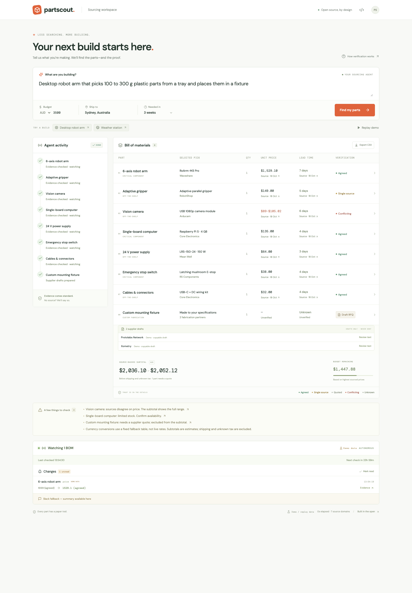
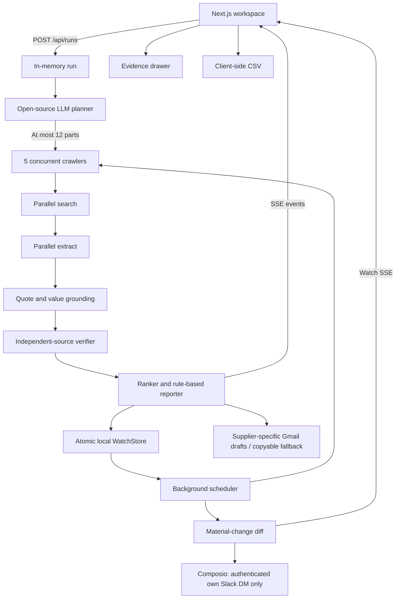

# PartScout

**Every part. Every source. Always watching.** PartScout spec v2: an MIT-licensed personal sourcing agent for hardware builders.
Describe a project, set a budget, destination, and deadline, and watch a bill of
materials arrive alongside live research activity. Each sourced value carries
a quotation, source link, and checked time. Missing values stay unknown. Finished
BOMs become Watch baselines automatically; background checks update the workspace
and notify only your own Slack DM when material facts change.



## Run locally

Requires Node.js 22.12+ and npm.

```sh
npm ci
cp .env.example .env.local
npm run dev
```

Open [localhost:3000](http://localhost:3000). The default is `MOCK=1`:
no service credentials or external requests are needed. Fonts are bundled locally.
Click **Find my parts** for a streamed illustrative run, or **Replay demo** for
the cached event log. The example chips select a robot arm or a weather station.
Open any BOM row to inspect the evidence. The custom fixture or enclosure has no
invented price. Supplier-specific RFQ drafts appear below its row automatically;
expand each to review and copy it. **Export CSV** works locally.

For the three-minute autonomous demo, add these to `.env.local` and restart:

```dotenv
DEMO_SCRIPT=1
WATCH_INTERVAL_SECONDS=60
```

After a run finishes, wait: the next cycle applies one illustrative price drop,
the following cycle changes stock, and the third simulates a supplier quote.
Changes arrive without clicking anything.
Every scripted or replayed value is visibly labeled **Demo data**. The default
interval is 86400 seconds (daily). `DEMO_SCRIPT=0` uses real crawlers for live BOMs;
illustrative/archived BOMs remain unchanged unless the scripted demo is enabled.

The shipped fixtures are explicitly **illustrative**, not recorded supplier prices.
Their second evidence domain uses the reserved `.example` TLD. Real supplier
links are references only; the fixture quotes have not been fetched from them.
Mock mode uses one of these two examples even when the goal is edited. Use live
mode for arbitrary goals.

## Live research

In `.env.local`, set `MOCK=0`, `PARALLEL_API_KEY`, and the following fields:

```dotenv
LLM_BASE_URL=https://api.groq.com/openai/v1
LLM_API_KEY=your-key
LLM_MODEL=llama-3.3-70b-versatile
```

Restart the server after changing environment values. The endpoint must support
OpenAI-compatible chat completions and `response_format: { type: "json_object" }`.
The default reasoning model is open-source Llama 3.3 70B; use any compatible
open-source model your provider supports. Output is validated with Zod, with
one retry for malformed JSON or schema failures. Invalid output is never used.
No keys are exposed to the browser. Missing live credentials cause an explicit
configuration error; PartScout never silently substitutes mock prices.

Parallel uses documented stable `POST /v1/search` and `POST /v1/extract` APIs.
Search discovers candidates; only extracted content can support listing values.
Each part uses 3–4 search queries, up to 5 candidate pages, and the orchestrator
limits active crawlers to 5. One failed part becomes an unknown row; other parts
continue. The planner asks at most two material clarifications and supports skip.

## Optional Composio integrations

Copyable RFQs and CSV need no integration. For Gmail drafts and Slack notifications,
connect **your own** Google and Slack accounts using Composio-managed OAuth, then put
the API key and the appropriate connected account IDs in `.env.local`:

```dotenv
COMPOSIO_API_KEY=your-key
COMPOSIO_GMAIL_CONNECTED_ACCOUNT_ID=your-connected-account
COMPOSIO_SLACK_CONNECTED_ACCOUNT_ID=your-slack-user-connected-account
COMPOSIO_TOOL_VERSION=latest
```

The [Composio account connection guide](https://docs.composio.dev/docs/authenticating-tools)
and [connected account API](https://docs.composio.dev/reference/api-reference/connected-accounts/postConnectedAccounts)
describe the auth configuration and redirect flow. This app consumes pre-connected
account IDs; it has no login system or in-app OAuth callback.

In Composio, create an Auth Config for toolkit **gmail**, connect your Google account,
and use the resulting connected account ID. `GMAIL_CREATE_EMAIL_DRAFT` needs
draft/compose access. One personalized draft is created per found supplier, with
returned draft and thread IDs stored on the BOM. A published contact email is used
only when it appears in fetched text. If no email is published, the adapter attempts
a recipient-free draft; if Composio requires a recipient, it keeps copyable text
instead. It never invents an address. Gmail failures do not stop other suppliers.
Mock and replay runs never create real Gmail drafts. No email-send tool exists.

For Slack choose toolkit **slack**, using a **user OAuth** connection, not **slackbot**.
Grant the scopes needed for `SLACK_TEST_AUTH`, `SLACK_LIST_ALL_CHANNELS` (IM listing,
including `im:read`), and `SLACK_SEND_MESSAGE` (message posting). Open your own DM
in Slack at least once. The adapter obtains your user ID from `SLACK_TEST_AUTH`,
pages through `types=im` conversations, and selects only a `D…` channel whose
`user` matches the authenticated identity. No recipient or channel setting is
accepted. Bot identities, public channels, group DMs, and other users are refused.
If Slack cannot be authenticated or your self DM cannot be verified, the exact
summary stays in the UI and persistent Watch metadata. A cached notification is
never presented as a newly sent message. Real scripted Watch cycles may notify
your own DM, with `[DEMO DATA]` clearly included.

The **only** automatic outbound message is a Watch summary to your own Slack DM.
Emails remain drafts; no orders, payments, or messages to third parties are supported.
CSV neutralizes formula-leading values. If OAuth setup takes more than 15 minutes,
use the copyable draft/UI summary fallback and finish the demo first.

Reply tracking reads only recorded RFQ thread IDs using
`GMAIL_FETCH_MESSAGE_BY_THREAD_ID`, so the Gmail connection also needs thread-read
access. Sent messages, drafts, spam, and trash are excluded. A reply must match
the recorded thread, arrive after the RFQ draft, and match the known recipient
email (or the verified supplier's domain when the recipient was unpublished).
Exact email quotations are checked by the same grounding logic. Matched prices,
lead times, and conditions are retained as `email_quote` evidence, shown in blue
as **Quoted**, and included in totals. Website evidence stays visible. Repeated
checks do not ingest the same message twice; an unrelated sender is never accepted.
Replies on a new thread after a human changes the subject cannot be matched.

## Autonomous Watch and storage

Next.js `src/instrumentation.ts` starts one process-wide scheduler on server boot.
Every completed run is saved automatically to `data/watched-boms.json`. `WatchStore`
uses a serialized read/modify/write queue, a private temporary file, then an atomic
rename. A corrupt existing file is preserved rather than silently replaced. `data/`
and all `.env` files are ignored by Git; keep this folder local and private.

One BOM is checked at a time and overlapping ticks are ignored. Watch does not
re-plan: it reuses the original requirements and the same crawler, grounding,
verifier, and reporter. Failed crawlers retain previous evidence and emit an error.
Price movement must exceed 5%, lead time must move by more than 3 days, or stock,
shipping, or verification status must change. Timestamp-only updates do not alert.
After reporting, the refreshed BOM becomes the baseline. Slack failure never rolls
back verified values or repeats the same change on every subsequent tick.

`/api/watch/events` stays open independently of the initial run stream. It sends
Watch status/countdown, changes with old/new values and evidence links, notification
results, updated BOMs, and a persisted snapshot on reconnect. The Changes feed has
an unread badge. Watch survives a browser close and a server restart; checks only
run while the local server is running. Run **one long-lived Node process**. There
is no database, distributed scheduler, serverless deployment, or third-party inbox.

## Verification

Evidence is grouped by normalized seller and product identity. Distinct sellers
and models are not treated as confirmation of one another. Registrable domains
are resolved with the public suffix list: subdomains of one website are one
source. Every quotation is checked against fetched content. Numeric values must
also occur in the quote; ambiguous bare dollar signs are dropped.

| Status        | Meaning                                                                                                             |
| ------------- | ------------------------------------------------------------------------------------------------------------------- |
| Agreed        | 2+ independent domains; prices within 5%, lead times within 3 calendar days, or matching categorical/boolean values |
| Conflicting   | Independent sources disagree; all evidence is retained, with a numeric range                                        |
| Single source | Exactly one independent domain supports the field                                                                   |
| Quoted        | A matched received supplier email supports the price/lead time; takes precedence while web evidence stays visible   |
| Unknown       | No supported value; unpriced parts require a quote and are excluded from the subtotal                               |

Only the newest observation per domain votes in a comparison, while every quote
remains in the drawer. Prices are normalized per unit, converted to the selected
currency, and stripped of tax only when an explicit included tax rate is known.
Business days convert conservatively with `ceil(days × 7/5)`; week ranges use their
upper end. A sourced median observation is displayed for agreement. Conflicting
prices show a range, and budget remaining uses its upper end. Whole packs are
included when a purchase requires more units than the build needs.

FX currently uses a **fixed, clearly labeled fallback table**, not market rates.
Shipping charges and unknown taxes are excluded. A subtotal is therefore an
estimate, not a supplier quote or guaranteed landed cost. Stock, destination
coverage, missing specs, and delivery uncertainties appear as rule-based risks.
Candidates that clearly fail requirements stay in the evidence drawer with the
rejection reason. Custom fabrication has no price until a received quote supports
one. A scripted quote is always labeled Demo data and never claimed as received mail.

## Architecture



All shared requests, data models, and stream events use Zod schemas. The small
`WebResearch`, `LLM`, `Mail`, `Notifier`, and `WatchStore` interfaces isolate external
services and persistence. No new full mock layer is required. There is no database.
The process-global map keeps up to
30 runs and prunes runs older than an hour on the next creation. SSE supports
event IDs, reconnecting from `Last-Event-ID`, and heartbeat comments.

```text
src/app/           Workspace UI and App Router API handlers
src/lib/           Shared Zod models, formatting, example goals, fixture builder
src/server/        Planner, crawlers, grounding, verifier, ranker, reporter
src/server/adapters/  Parallel, chat-completion, and Composio adapters
src/server/watch/  Scheduler, atomic store, diffs, scripted changes, Watch SSE bus
data/              Private watched BOM baselines and evidence (gitignored)
fixtures/          Complete timed illustrative event logs for both example goals
scripts/           Demo recorder and HTTP smoke test
```

## Check the build

```sh
npm run typecheck
npm test
npm run build
# With the local server running in MOCK=1:
npm run test:smoke
```

Unit tests cover domain independence, price and time tolerances, currency, packs,
tax, absent evidence, rejected candidates, grounded quotations, conservative
totals, budget risks, crawler concurrency/failure isolation, clarifications, model
retry behavior, and CSV formula escaping. The HTTP smoke test checks progressive
SSE, both goals, verification statuses, RFQs, CSV content, replay in USD, and resume.
Watch tests cover strict material thresholds, atomic persistence, corrupted-file
preservation, no overlapping checks, and supplier/integration failure isolation.
Slack tests verify that only the authenticated user's own DM can be targeted.
The v2 build was also checked in a real browser: evidence drawer, supplier RFQ
expansion, verification guide, and 1280/1024/375 px layouts without page overflow.

For the dedicated Watch HTTP smoke test, start a separate process with `MOCK=1`,
`DEMO_SCRIPT=1`, `WATCH_INTERVAL_SECONDS=2`, empty Composio keys, and
`PARTSCOUT_WATCH_FILE` pointing to a temporary JSON file. Then run
`PARTSCOUT_URL=http://localhost:3002 npm run test:watch-smoke`. This checks two
automatic cycles, RFQs, change evidence, quoted values, Slack fallback, and reconnect snapshots.
`PARTSCOUT_WATCH_FILE` is a test isolation override; normal storage stays in `data/`.

For production, use `npm run build && npm start` on a **single long-lived Node
process** with streaming enabled. Keep requests for the same run on that process.
Static hosting and horizontally scaled/serverless instances cannot share this
in-memory store. Do not expose connected accounts on a public unauthenticated
instance; this is a personal, local hackathon app.

## Record a real demo

Finish a live run, retrieve its run ID from the `POST /api/runs` response, then:

```sh
npm run demo:record -- --run-id=YOUR_RUN_ID
```

This saves the full timed log to `fixtures/demo-run.json`. Review its goal,
destination, and quotes for personal information before committing. Replays retain
the original evidence timestamps and compress timing; they re-normalize prices
and risks against the current currency, budget, and deadline. Cached robot-arm
parts remain the robot-arm scenario; replay is not new research on an edited goal.
To restore the two known illustrative fixtures:

```sh
npm run demo:record -- --illustrative
```

## Decisions and limitations

- The explicit Next.js App Router requirement is preserved; no database,
  authentication, ordering, or checkout was added. Automatic Slack messaging is
  restricted to the connected user's own DM. Google Sheets was removed per v2.
- Composio uses pre-connected accounts so OAuth cannot block the main demo.
- Source agreement is conservative: different seller/product groups are never
  combined just to produce a green label. Unknowns are expected in real research.
- The ranker prioritizes eligible destinations, stock, and deadlines; then sourced
  spec coverage, cost, and lead time. If the full known BOM exceeds the budget,
  it considers cheaper supported alternatives, preferring the smallest loss of
  verified spec coverage. Unverified specs stay visible as risks. If no eligible
  combination can fit, it reports the budget failure explicitly. This bounded
  greedy adjustment is not a general optimization solver.
- Cline's CLI was not installed in the build environment; development was carried
  out with Codex. The repo can be opened in Cline. No claim of Cline execution is made.
- The supplied cache is illustrative because live API credentials were not
  available during this build. Live and Google integrations require your keys
  and connected accounts for an end-to-end service check.
- CRM, chat panels, Sheets, PDF/image specialists, and serverless hosting are out of scope.
- Use public supplier pages through the research API and respect site terms and
  access restrictions. A source link is evidence for review, not permission to buy.

## API and documentation references

- [Parallel Search](https://docs.parallel.ai/api-reference/search/search)
- [Parallel Extract](https://docs.parallel.ai/api-reference/extract/extract)
- [Parallel OpenAPI schema](https://docs.parallel.ai/public-openapi.json)
- [Composio Gmail](https://docs.composio.dev/toolkits/gmail)
- [Composio Slack](https://docs.composio.dev/toolkits/slack)
- [Composio tool execution](https://docs.composio.dev/reference/api-reference/tools/postToolsExecuteByToolSlug)

MIT License © 2026 PartScout contributors. See [LICENSE](LICENSE).
