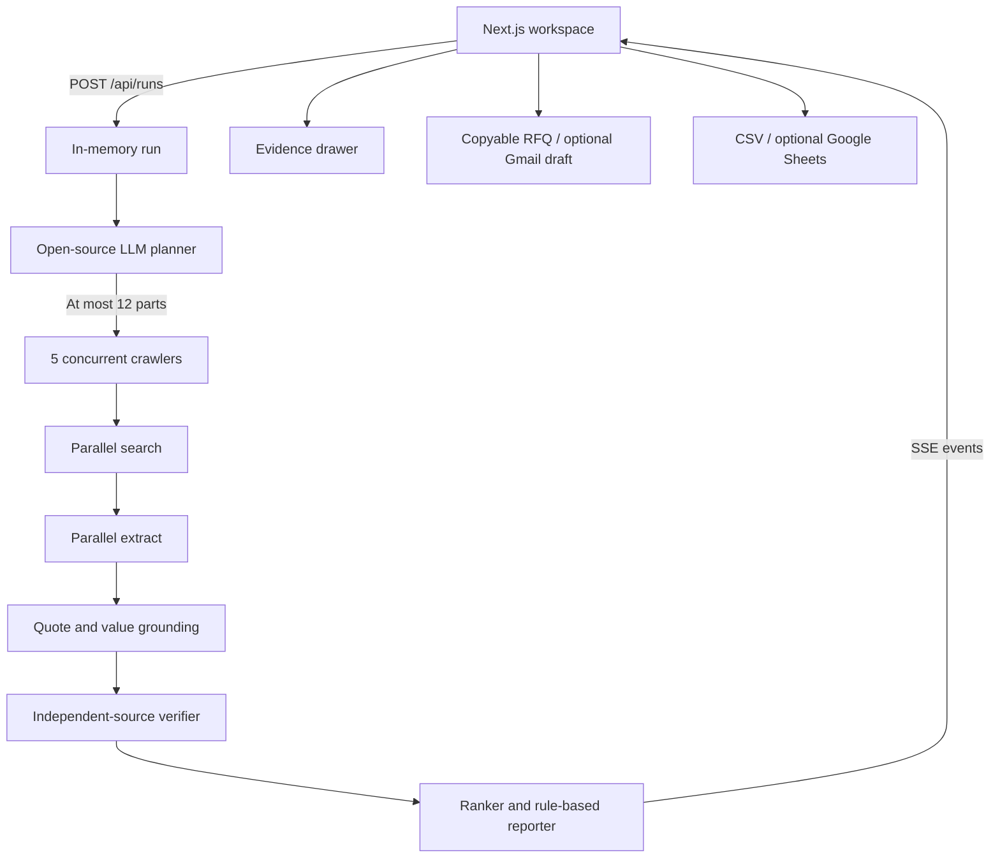

# PartScout

**Every part. Every source.** An MIT-licensed sourcing agent for hardware builders.
Describe a project, set a budget, destination, and deadline, and watch a bill of
materials arrive alongside live research activity. Each sourced value carries
a quotation, source link, and checked time. Missing values stay unknown.

## Run locally

Requires Node.js 22.12+ and npm.

```sh
npm ci
cp .env.example .env.local
npm run dev
```

Open [localhost:3000](http://localhost:3000). The default is `MOCK=1`:
no service credentials or external requests are needed. Fonts are bundled locally.
Click **Find my parts** for a streamed illustrative run, or **Replay demo** for
the cached event log. The example chips select a robot arm or a weather station.
Open any BOM row to inspect the evidence. The custom fixture or enclosure has no
invented price: use **Draft RFQ** to get copyable text. **Export CSV** works locally.

The shipped fixtures are explicitly **illustrative**, not recorded supplier prices.
Their second evidence domain uses the reserved `.example` TLD. Real supplier
links are references only; the fixture quotes have not been fetched from them.
Mock mode uses one of these two examples even when the goal is edited. Use live
mode for arbitrary goals.

## Live research

In `.env.local`, set `MOCK=0`, `PARALLEL_API_KEY`, and the following fields:

```dotenv
LLM_BASE_URL=https://api.groq.com/openai/v1
LLM_API_KEY=your-key
LLM_MODEL=llama-3.3-70b-versatile
```

Restart the server after changing environment values. The endpoint must support
OpenAI-compatible chat completions and `response_format: { type: "json_object" }`.
The default reasoning model is open-source Llama 3.3 70B; use any compatible
open-source model your provider supports. Output is validated with Zod, with
one retry for malformed JSON or schema failures. Invalid output is never used.
No keys are exposed to the browser. Missing live credentials cause an explicit
configuration error; PartScout never silently substitutes mock prices.

Parallel uses documented stable `POST /v1/search` and `POST /v1/extract` APIs.
Search discovers candidates; only extracted content can support listing values.
Each part uses 3–4 search queries, up to 5 candidate pages, and the orchestrator
limits active crawlers to 5. One failed part becomes an unknown row; other parts
continue. The planner asks at most two material clarifications and supports skip.

## Optional Composio integrations

Copyable RFQs and CSV need no integration. For Gmail drafts or Sheets, connect
**your own** Google account in Composio using its managed OAuth flow, then put
the API key and the appropriate connected account IDs in `.env.local`:

```dotenv
COMPOSIO_API_KEY=your-key
COMPOSIO_GMAIL_CONNECTED_ACCOUNT_ID=your-connected-account
COMPOSIO_SHEETS_CONNECTED_ACCOUNT_ID=your-connected-account
COMPOSIO_TOOL_VERSION=latest
```

The [Composio account connection guide](https://docs.composio.dev/docs/authenticating-tools)
and [connected account API](https://docs.composio.dev/reference/api-reference/connected-accounts/postConnectedAccounts)
describe the auth configuration and redirect flow. This app consumes pre-connected
account IDs; it has no login system or in-app OAuth callback.

The human first creates an RFQ, then supplies the recipient and explicitly clicks
**Save Gmail draft**. Nothing is sent. The adapter allows only
`GMAIL_CREATE_EMAIL_DRAFT`, `GOOGLESHEETS_CREATE_GOOGLE_SHEET1`, and
`GOOGLESHEETS_VALUES_UPDATE`. No sending tool is available to the agent.
Sheets writes values as `RAW`; CSV neutralizes formula-leading values. If an
integration fails, copyable text and CSV remain available. Mock and replay runs
never write to Google accounts.

## Verification

Evidence is grouped by normalized seller and product identity. Distinct sellers
and models are not treated as confirmation of one another. Registrable domains
are resolved with the public suffix list: subdomains of one website are one
source. Every quotation is checked against fetched content. Numeric values must
also occur in the quote; ambiguous bare dollar signs are dropped.

| Status        | Meaning                                                                                                             |
| ------------- | ------------------------------------------------------------------------------------------------------------------- |
| Agreed        | 2+ independent domains; prices within 5%, lead times within 3 calendar days, or matching categorical/boolean values |
| Conflicting   | Independent sources disagree; all evidence is retained, with a numeric range                                        |
| Single source | Exactly one independent domain supports the field                                                                   |
| Unknown       | No supported value; unpriced parts require a quote and are excluded from the subtotal                               |

Only the newest observation per domain votes in a comparison, while every quote
remains in the drawer. Prices are normalized per unit, converted to the selected
currency, and stripped of tax only when an explicit included tax rate is known.
Business days convert conservatively with `ceil(days × 7/5)`; week ranges use their
upper end. A sourced median observation is displayed for agreement. Conflicting
prices show a range, and budget remaining uses its upper end. Whole packs are
included when a purchase requires more units than the build needs.

FX currently uses a **fixed, clearly labeled fallback table**, not market rates.
Shipping charges and unknown taxes are excluded. A subtotal is therefore an
estimate, not a supplier quote or guaranteed landed cost. Stock, destination
coverage, missing specs, and delivery uncertainties appear as rule-based risks.
Candidates that clearly fail requirements stay in the evidence drawer with the
rejection reason. Custom fabrication never receives a generated price.

## Architecture



All shared requests, data models, and stream events use Zod schemas. The small
`WebResearch`, `LLM`, `Drafts`, and `SheetsExport` interfaces each have real and
mock implementations. There is no database. The process-global map keeps up to
30 runs and prunes runs older than an hour on the next creation. SSE supports
event IDs, reconnecting from `Last-Event-ID`, and heartbeat comments.

```text
src/app/           Workspace UI and App Router API handlers
src/lib/           Shared Zod models, formatting, example goals, fixture builder
src/server/        Planner, crawlers, grounding, verifier, ranker, reporter
src/server/adapters/  Parallel, chat-completion, and Composio adapters
fixtures/          Complete timed illustrative event logs for both example goals
scripts/           Demo recorder and HTTP smoke test
```

## Check the build

```sh
npm run typecheck
npm test
npm run build
# With the local server running in MOCK=1:
npm run test:smoke
```

Unit tests cover domain independence, price and time tolerances, currency, packs,
tax, absent evidence, rejected candidates, grounded quotations, conservative
totals, budget risks, crawler concurrency/failure isolation, clarifications, model
retry behavior, and CSV formula escaping. The HTTP smoke test checks progressive
SSE, both goals, verification statuses, RFQs, CSV content, replay in USD, and resume.

For production, use `npm run build && npm start` on a **single long-lived Node
process** with streaming enabled. Keep requests for the same run on that process.
Static hosting and horizontally scaled/serverless instances cannot share this
in-memory store. Do not expose connected accounts on a public unauthenticated
instance; this is a personal, local hackathon app.

## Record a real demo

Finish a live run, retrieve its run ID from the `POST /api/runs` response, then:

```sh
npm run demo:record -- --run-id=YOUR_RUN_ID
```

This saves the full timed log to `fixtures/demo-run.json`. Review its goal,
destination, and quotes for personal information before committing. Replays retain
the original evidence timestamps and compress timing; they re-normalize prices
and risks against the current currency, budget, and deadline. Cached robot-arm
parts remain the robot-arm scenario; replay is not new research on an edited goal.
To restore the two known illustrative fixtures:

```sh
npm run demo:record -- --illustrative
```

## Decisions and limitations

- The explicit Next.js App Router requirement is preserved; no database,
  authentication, ordering, checkout, or automated messaging was added.
- Composio uses pre-connected accounts so OAuth cannot block the main demo.
- Source agreement is conservative: different seller/product groups are never
  combined just to produce a green label. Unknowns are expected in real research.
- The ranker prioritizes eligible destinations, stock, and deadlines; then sourced
  spec coverage, cost, and lead time. If the full known BOM exceeds the budget,
  it considers cheaper supported alternatives, preferring the smallest loss of
  verified spec coverage. Unverified specs stay visible as risks. If no eligible
  combination can fit, it reports the budget failure explicitly. This bounded
  greedy adjustment is not a general optimization solver.
- Cline's CLI was not installed in the build environment; development was carried
  out with Codex. The repo can be opened in Cline. No claim of Cline execution is made.
- The supplied cache is illustrative because live API credentials were not
  available during this build. Live and Google integrations require your keys
  and connected accounts for an end-to-end service check.
- PDF/image specialists and a recorded browser demo are left as stretch work.
- Use public supplier pages through the research API and respect site terms and
  access restrictions. A source link is evidence for review, not permission to buy.

## API and documentation references

- [Parallel Search](https://docs.parallel.ai/api-reference/search/search)
- [Parallel Extract](https://docs.parallel.ai/api-reference/extract/extract)
- [Parallel OpenAPI schema](https://docs.parallel.ai/public-openapi.json)
- [Composio Gmail](https://docs.composio.dev/toolkits/gmail)
- [Composio Google Sheets](https://docs.composio.dev/toolkits/googlesheets)
- [Composio tool execution](https://docs.composio.dev/reference/api-reference/tools/postToolsExecuteByToolSlug)

MIT License © 2026 PartScout contributors. See [LICENSE](LICENSE).
